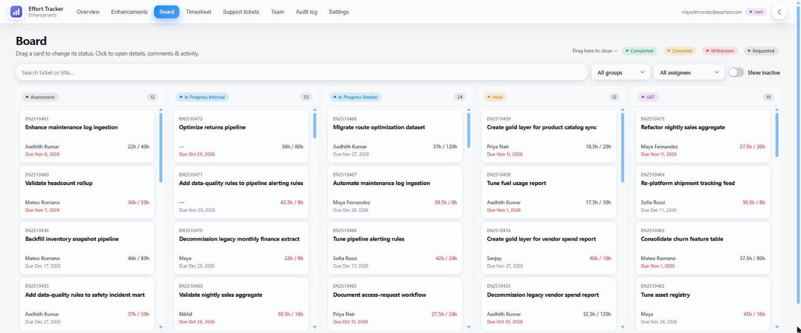
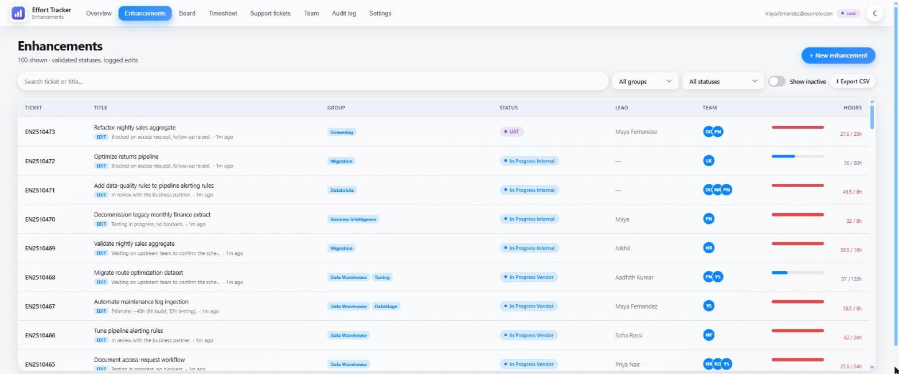

# Effort Tracker — Databricks App

A team **enhancement, timesheet and support tracker** that replaces an error-prone,
ever-growing spreadsheet (a daily grid of hundreds of columns, hand-built pivots,
no audit trail) with a validated, logged web app deployed as a **Databricks App**.

> Portfolio project. **All data is fictional** — people, tickets, emails and numbers
> are generated by `migration/seed_dummy.py`. The lead login is whoever is listed in `ADMIN_EMAILS`.


<picture>
  <source media="(prefers-color-scheme: dark)" srcset="docs/screenshots/overview-dark.jpg">
  
</picture>

<table>
  <tr>
    <td><picture>
  <source media="(prefers-color-scheme: dark)" srcset="docs/screenshots/board-dark.jpg">
  
</picture></td>
    <td><picture>
  <source media="(prefers-color-scheme: dark)" srcset="docs/screenshots/timesheet-dark.jpg">
  
</picture></td>
  </tr>
</table>

<picture>
  <source media="(prefers-color-scheme: dark)" srcset="docs/screenshots/enhancements-dark.jpg">
  
</picture>

<sub>Screenshots follow your GitHub theme: dark mode shows the app's dark theme. All data is fictional.</sub>

## Why this exists

| Spreadsheet pain | App fix |
|---|---|
| A new **column every day** (hundreds and growing) | `effort` table: **one row per ticket · date · person** |
| Two drifting status fields, free-text typos (`Canceled`/`Cancelled`) | Lookup-driven **dropdowns** with validation |
| `DO NOT UPDATE` sheets — edits aren't safe | Row-level edits + constraints + transactions |
| No record of who changed what | Append-only **audit log** on every write |
| Manual Monthly / Summary pivots | **Live dashboard** aggregations |

## Architecture

```
React SPA (clean, minimal UI)  ──HTTP──>  FastAPI  ──SQL──>  Lakebase (Postgres, OLTP)
   frontend/                           backend/            backend/sql/001_schema.sql
                                                              │ optional nightly sync
                                                              ▼
                                                   Delta table (Unity Catalog) → BI
```

- **Frontend** — React 18 + Vite, Recharts, Framer Motion. Custom design system: tokens, light/dark themes, motion (`frontend/src/styles.css`).
- **Backend** — FastAPI + SQLAlchemy. SSO user resolved from Databricks forwarded headers; three server-enforced roles (lead / member / viewer).
- **Data** — Lakebase (managed Postgres) for live/edit/audit; can be mirrored to Delta for reporting.
- **Local dev** — falls back to a SQLite file automatically, so it runs with zero infra.

## Data model (`backend/sql/001_schema.sql`)

- `grp`, `status`, `sub_status`, `skill_category` — lookups that power dropdowns.
- `resource` — team members. The `is_lead` flag + SSO email resolve the lead role.
- `enhancement` — the tickets. Actual/remaining hours are **computed**, never typed.
- `effort` — daily time, one row per (enhancement, resource, group, skill, date).
- `support_ticket` / `support_comment` — standalone support tracker with an activity feed.
- `audit_log` — append-only who/when/old→new.

## Run it locally

```bash
# 1. Backend (creates SQLite tables on startup)
cd backend
python -m venv .venv && . .venv/Scripts/activate   # Windows: .venv\Scripts\activate
pip install -r requirements.txt
uvicorn app.main:app --reload --port 8000

# 2. Load fictional demo data into the local DB (from repo root)
python migration/seed_dummy.py            # or --reset to wipe and re-seed

# 3. Frontend (separate terminal)
cd frontend
npm install
npm run dev            # http://localhost:5173  (proxies /api to :8000)
```

Production build (served by FastAPI itself): `cd frontend && npm run build` →
emits `frontend/dist`, which `app.main` serves at `/`.

## Deploy to Databricks

See **[DEPLOY.md](DEPLOY.md)** for the full walkthrough and **[DATABASE.md](DATABASE.md)**
for the schema + exactly what to run against Lakebase. In short:

1. **Create a Lakebase database** in the workspace (SQL → Lakebase).
2. Build the frontend (`npm run build`) so `frontend/dist` exists.
3. `databricks sync` the repo to your workspace, then `databricks apps create effort-tracker`.
4. Add the Lakebase instance as an **app Resource** (injects `PG*`; the app uses its
   service-principal OAuth token as the Postgres password).
5. Seed the schema + fictional data: `powershell -File scripts/seed-lakebase.ps1`.
6. `databricks apps deploy effort-tracker`.

Databricks Apps provide **SSO** automatically — the signed-in workspace user's email
arrives in `X-Forwarded-Email` and is written to every audit row. `ADMIN_EMAILS` in
`app.yaml` (set from a deploy secret) always gets the lead role.

## API surface

| Method | Path | Purpose |
|---|---|---|
| GET | `/api/dashboard/*` | KPIs, by-status, by-group, hours-by-month/resource |
| GET/POST/PUT/DELETE | `/api/enhancements` | ticket CRUD (actual/remaining computed) |
| GET/POST/PUT/DELETE | `/api/efforts`, `/api/timesheet` | daily time entry (cap + weekly freeze) |
| GET/POST/PUT | `/api/resources` | team members |
| GET/POST/PUT/DELETE | `/api/support-tickets` | support tracker |
| GET | `/api/lookups` | dropdown values |
| GET | `/api/audit` | change history |
| GET/PUT | `/api/settings` | freeze rule, daily cap, lookups (leads) |

## Project layout

```
backend/
  app/            FastAPI app (routers, models, schemas, audit, auth)
  sql/001_schema.sql   Lakebase/Postgres DDL
  tests/          API behaviour tests (throwaway SQLite)
frontend/
  src/pages/      Overview, Enhancements, Board, Timesheet, Support, Team, Audit, Settings
  src/components/ shared UI components and design tokens
migration/
  seed_dummy.py        generate fictional demo data (SQLite or Lakebase)
  migrate_excel.py     optional: import a real workbook (un-pivots a wide daily grid)
app.yaml          Databricks App spec
```
