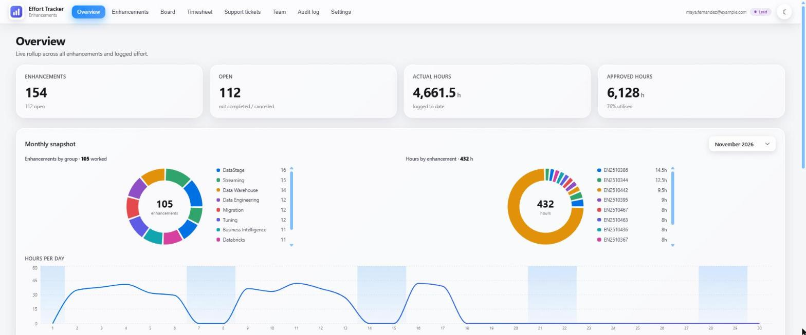
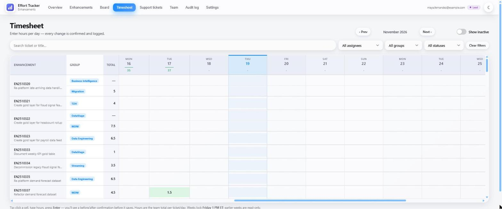

# Effort Tracker — Databricks App

A team **enhancement, timesheet and support tracker** that replaces an error-prone,
ever-growing spreadsheet (a daily grid of hundreds of columns, hand-built pivots,
no audit trail) with a validated, logged web app deployed as a **Databricks App**.

> Portfolio project. **All data is fictional** — people, tickets, emails and numbers
> are generated by `migration/seed_dummy.py`. The lead login is whoever is listed in `ADMIN_EMAILS`.


<picture>
  <source media="(prefers-color-scheme: dark)" srcset="docs/screenshots/overview-dark.jpg">
  
</picture>

<table>
  <tr>
    <td><picture>
  <source media="(prefers-color-scheme: dark)" srcset="docs/screenshots/board-dark.jpg">
  
</picture></td>
    <td><picture>
  <source media="(prefers-color-scheme: dark)" srcset="docs/screenshots/timesheet-dark.jpg">
  
</picture></td>
  </tr>
</table>

<picture>
  <source media="(prefers-color-scheme: dark)" srcset="docs/screenshots/enhancements-dark.jpg">
  
</picture>

<sub>Screenshots follow your GitHub theme: dark mode shows the app's dark theme. All data is fictional.</sub>

## Why this exists

| Spreadsheet pain | App fix |
|---|---|
| A new **column every day** (hundreds and growing) | `effort` table: **one row per ticket · date · person** |
| Two drifting status fields, free-text typos (`Canceled`/`Cancelled`) | Lookup-driven **dropdowns** with validation |
| `DO NOT UPDATE` sheets — edits aren't safe | Row-level edits + constraints + transactions |
| No record of who changed what | Append-only **audit log** on every write |
| Manual Monthly / Summary pivots | **Live dashboard** aggregations |

## Architecture

```
React SPA (clean, minimal UI)  ──HTTP──>  FastAPI  ──SQL──>  Lakebase (Postgres, OLTP)
   frontend/                           backend/            backend/sql/001_schema.sql
                                                              │ optional nightly sync
                                                              ▼
                                                   Delta table (Unity Catalog) → BI
```

- **Frontend** — React 18 + Vite, Recharts, Framer Motion. Custom design system: tokens, light/dark themes, motion (`frontend/src/styles.css`).
- **Backend** — FastAPI + SQLAlchemy. SSO user resolved from Databricks forwarded headers; three server-enforced roles (lead / member / viewer).
- **Data** — Lakebase (managed Postgres) for live/edit/audit; can be mirrored to Delta for reporting.
- **Local dev** — falls back to a SQLite file automatically, so it runs with zero infra.

## Data model (`backend/sql/001_schema.sql`)

- `grp`, `status`, `sub_status`, `skill_category` — lookups that power dropdowns.
- `resource` — team members. The `is_lead` flag + SSO email resolve the lead role.
- `enhancement` — the tickets. Actual/remaining hours are **computed**, never typed.
- `effort` — daily time, one row per (enhancement, resource, group, skill, date).
- `support_ticket` / `support_comment` — standalone support tracker with an activity feed.
- `audit_log` — append-only who/when/old→new.

Schema changes are versioned with **Alembic** (`backend/alembic/versions/`); see
[DEVELOPMENT.md](DEVELOPMENT.md).

## Roles

Identity comes from Databricks SSO; the role is checked on the server for every request.

| Role | Who | Can do |
|---|---|---|
| **Lead** | `ADMIN_EMAILS`, or a team member flagged `is_lead` | Everything: edit enhancements and the team, change settings, read the audit log |
| **Member** | Any active team member | Log time, move cards on the board, update their own contact details |
| **Viewer** | Anyone else signed in | Read every page except the audit log; Settings is read-only |

## Security

- **CSRF guard:** every API write must send an `X-Requested-With` header. The app's own
  frontend sends it; a forged request from another site can't.
- **Security headers** on every response: Content-Security-Policy, `X-Frame-Options: DENY`,
  `nosniff`, HSTS and a strict referrer policy.
- **Path-traversal guard:** the server only serves files from the built frontend.
- **CORS off by default;** enable it only for named origins via `CORS_ORIGINS`.
- **Structured JSON logs;** refused requests are logged as `authz_denied` with the user.
- **Input limits** on text fields and **pagination** (`limit`/`offset`, max 500) on lists.

## Run it locally

```bash
# 1. Backend (creates SQLite tables on startup)
cd backend
python -m venv .venv && . .venv/Scripts/activate   # Windows: .venv\Scripts\activate
pip install -r requirements.txt
uvicorn app.main:app --reload --port 8000

# 2. Load fictional demo data into the local DB (from repo root)
python migration/seed_dummy.py            # or --reset to wipe and re-seed

# 3. Frontend (separate terminal)
cd frontend
npm install
npm run dev            # http://localhost:5173  (proxies /api to :8000)
```

Production build (served by FastAPI itself): `cd frontend && npm run build` →
emits `frontend/dist`, which `app.main` serves at `/`.

To run the API with the demo data loaded automatically, start it with `SEED_DEMO=1`.

## Tests and checks

```bash
cd backend && python -m pytest        # 27 API tests on a throwaway SQLite DB
python -m ruff check app              # lint
cd ../frontend && npm run lint        # ESLint
```

## CI/CD

`.github/workflows/ci-cd.yml` runs on every push and pull request:

1. **Backend:** ruff, bandit (security lint), pip-audit (advisory), pytest.
2. **Frontend:** npm audit (advisory), ESLint, production build.
3. **Deploy** (pushes to `main` only): bundles the app, uploads it to the workspace, starts
   the app if Databricks has stopped it, runs `databricks apps deploy`, then checks it is running.

Deploy needs three repository secrets: `DATABRICKS_HOST`, `DATABRICKS_TOKEN` and
`ADMIN_EMAILS`. Without them the deploy job is skipped and the checks still run.

## Deploy to Databricks (first time)

See **[DEPLOY.md](DEPLOY.md)** for the full walkthrough and **[DATABASE.md](DATABASE.md)**
for the schema. In short:

1. **Create a Lakebase database** in the workspace and the app (`databricks apps create effort-tracker`).
2. Add the Lakebase database as an **app Resource** (injects `PG*`; the app uses its
   service-principal OAuth token as the Postgres password).
3. Add the three GitHub secrets above and push to `main`. The demo creates its tables
   and loads fictional data on first boot (`AUTO_INIT_DB=1`, `SEED_DEMO=1`); for a managed
   database, run Alembic migrations instead (`scripts/migrate-lakebase.ps1`).

Databricks Apps provide **SSO** automatically: the signed-in user's email arrives in
`X-Forwarded-Email` and is written to every audit row. `ADMIN_EMAILS` (a deploy secret,
injected into `app.yaml` at deploy time) always gets the lead role.

## API surface

All writes (POST/PUT/DELETE) need the `X-Requested-With` header. Lists accept
`limit` and `offset`.

| Method | Path | Purpose |
|---|---|---|
| GET | `/api/dashboard/*` | KPIs, by-status, by-group, hours-by-month/resource |
| GET/POST/PUT/DELETE | `/api/enhancements` | ticket CRUD (actual/remaining computed); delete also removes its comments and groups |
| GET/POST/PUT/DELETE | `/api/efforts`, `/api/timesheet` | daily time entry: per-person daily cap, weekly lock, month freeze |
| GET/POST/PUT | `/api/resources` | team members |
| GET/POST/PUT/DELETE | `/api/support-tickets` | support tracker (can only be closed once its status is final) |
| GET | `/api/lookups` | dropdown values |
| GET | `/api/audit` | change history (leads only) |
| GET/PUT/POST | `/api/settings` | freeze rule, statuses, groups (anyone reads; leads change) |
| GET | `/api/me`, `/api/health` | current user and role; health check |

## Project layout

```
.github/workflows/ci-cd.yml   lint, security checks, tests, build, deploy
backend/
  app/            FastAPI app (routers, models, schemas, audit, auth, logging)
  alembic/        versioned schema migrations
  sql/001_schema.sql   Lakebase/Postgres DDL
  tests/          API behaviour tests (throwaway SQLite)
frontend/
  src/pages/      Overview, Enhancements, Board, Timesheet, Support, Team, Audit, Settings
  src/components/ shared UI components and design tokens
migration/
  seed_dummy.py        generate fictional demo data (SQLite or Lakebase)
  migrate_excel.py     optional: import a real workbook (un-pivots a wide daily grid)
scripts/
  build_bundle.py      assemble the deployable app (used by CI)
  *.ps1                manual helpers: seed, migrate, grant, deploy
app.yaml          Databricks App spec
```
