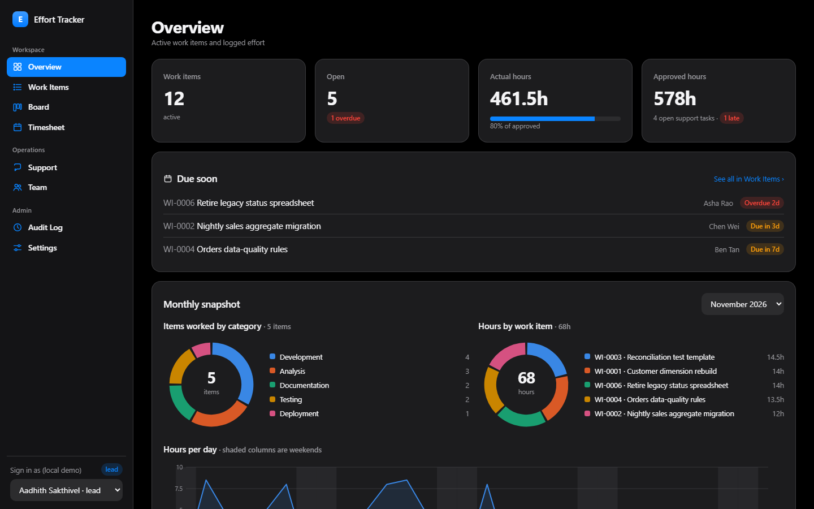
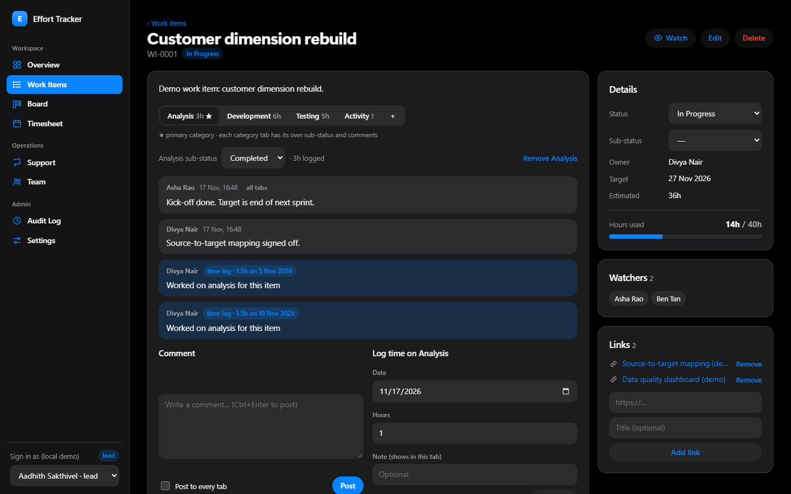
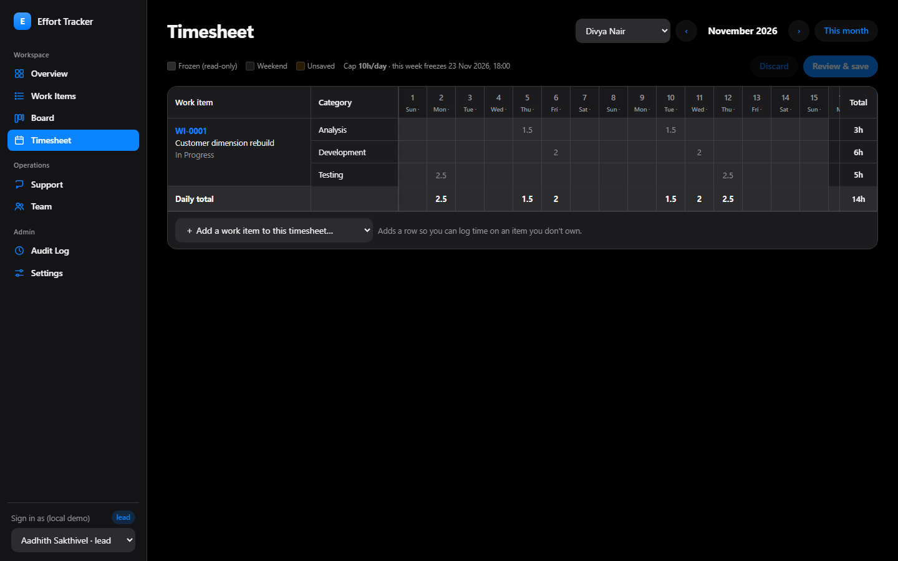
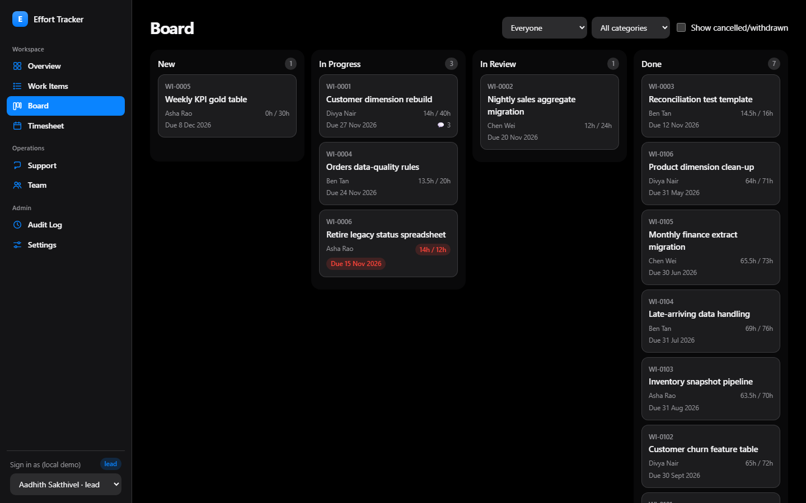
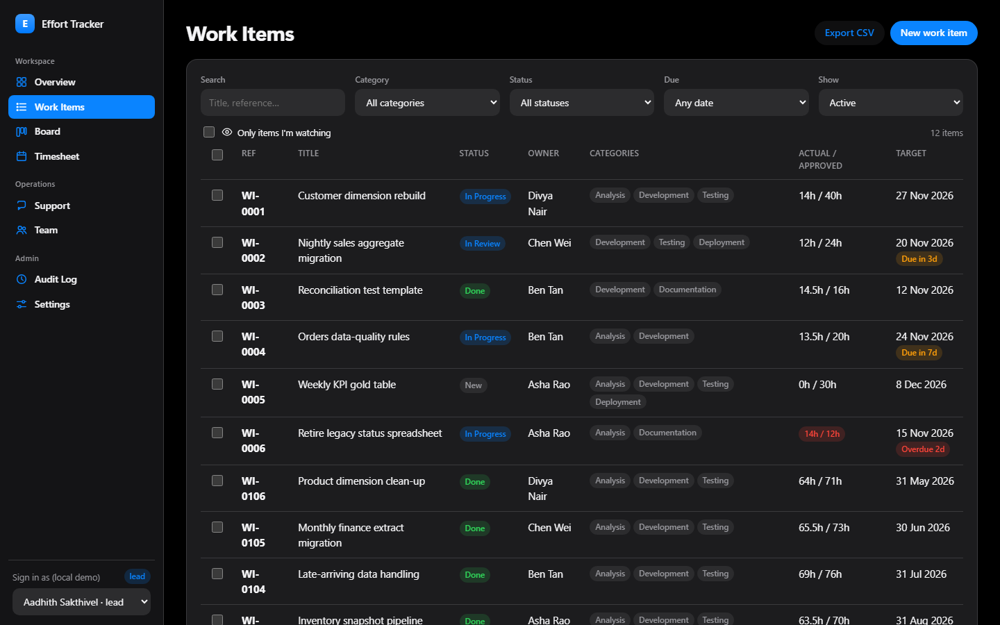
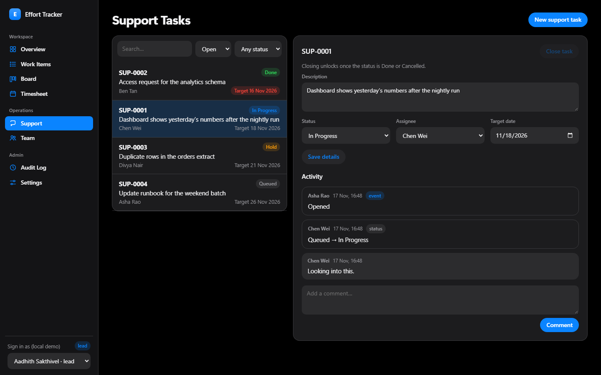
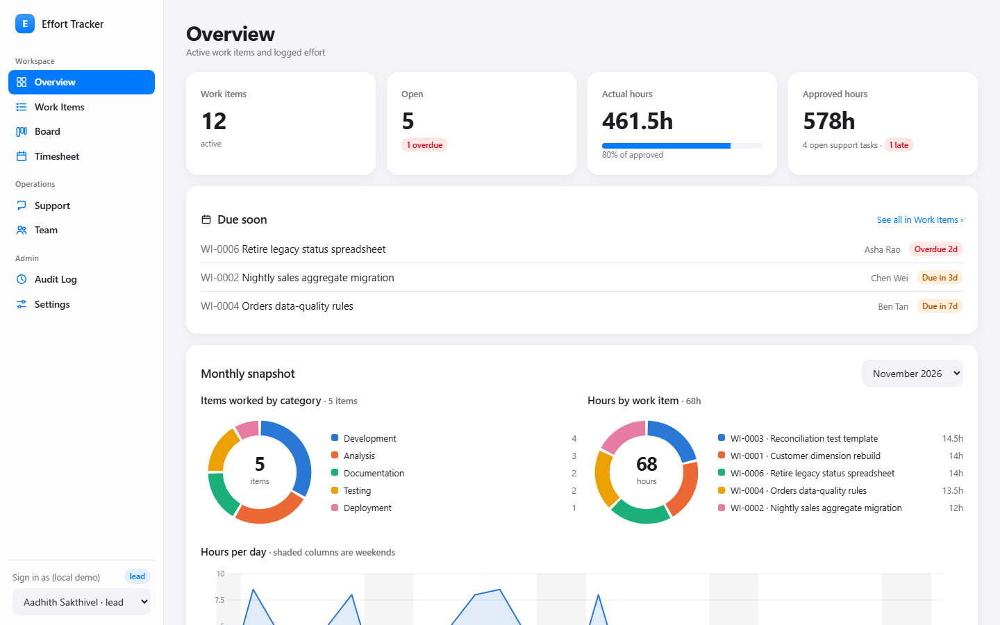

# Effort Tracker

A team effort, timesheet and support tracker that replaces scattered spreadsheets with one shared, audited app.
It's built as a **Databricks App** on **Lakebase (Postgres)** and runs locally with zero setup.

> Clean-room portfolio project, built from a generic functional spec ([SPEC.md](SPEC.md)). All demo data is fictional.



| | |
|---|---|
|  |  |
| **Work item:** category tabs, activity timeline, inspector with watchers and links | **Timesheet:** month grid, frozen weeks, daily cap |
|  |  |
| **Board:** drag cards between statuses | **Work items:** filters, due reminders, bulk edit |
|  |  |
| **Support tasks:** activity feed, close only when done | **Light and dark mode** follow the system setting |

## Features
| Screen | What it does |
|---|---|
| **Overview** | KPI tiles, a **Due soon** reminder list, a monthly snapshot (doughnuts for items by category and hours by item, hours-per-day line), effort by month, items by status, hours by category, burn vs approved |
| **Work Items** | Search and filter by category, status, due date (overdue / next 7 days), active state and **items I'm watching**. Due-date reminder badges. Leads create/edit/delete and **bulk-edit** status, owner or target date. CSV export with a column picker and its own filters |
| **Work Item detail** | Header facts, then **a tab per category**, each with its own sub-status and comment thread. Card-level comments show on every tab; time-log notes appear under their category. Leads add shared or item-only custom categories. An **Activity** tab shows the item's full history; the side inspector has details, an hours meter, **watchers** and **reference links** |
| **Board** | Kanban by status. Drag a card to change status (members and leads); click to open |
| **Timesheet** | Month grid with one row per work item × category (item name spans its rows). Type hours per day, review a before/after confirmation, save. Weeks **freeze** after a weekly deadline; a **daily hour cap** is enforced |
| **Support Tasks** | Queued → In Progress → Hold → Done / Cancelled, with assignee, target date and an activity feed. **Closing is blocked** until the task is Done or Cancelled |
| **Team** | Member cards with filters, CSV export, **reveal-to-call** contact details (hidden from viewers), confirm-before activate/deactivate |
| **Audit Log** | Every create/update/delete with field, old → new, who and when. Filter by entity |
| **Settings** (leads) | Daily cap, freeze rule, configurable statuses and sub-statuses, shared categories |

The sidebar shows a badge with **your items that are overdue or due within 7 days**. Everything is keyboard-reachable (skip link, Enter opens cards and rows), respects reduced motion, and works from 375 px phones to wide desktops.

**Roles** are enforced on the server: **Lead** (full edit), **Member** (time, statuses, comments, support), **Viewer** (read-only).

## Architecture
```
Browser (vanilla JS SPA, no build step)
   │  REST /api/*
Node.js + Express  ── identity: Databricks SSO headers → users table → role
   │  routes/: work-items · timesheet · support · team · reports · meta
   │  lib/: auth · audit · time (business TZ + freeze) · time-entries (cap/freeze rules)
Postgres
   ├─ Lakebase on Databricks (OAuth token from the app's service principal)
   └─ PGlite locally (embedded Postgres, persisted to ./.data)
db/migrations/NNN_*.sql  ── versioned, applied once at startup
```

## Run locally
```bash
npm install
npm start            # http://localhost:8000
```
It starts with demo data. Use the **Sign in as** picker (top right) to switch between a lead, members and a viewer and see the permissions change. Run `npm run reset` to wipe the local database.

```bash
npm test             # 12 requirement tests against a throwaway database
```
See [REQUIREMENTS.md](REQUIREMENTS.md) for the spec-to-code checklist.

## Deploy to Databricks Apps
> **Status:** deployed and running on Databricks Apps (Free Edition) with a **Lakebase** Postgres database (dedicated `effort_tracker` schema), SSO sign-in and server-side roles. Data verified to persist across app restarts on 17 Nov 2026.

1. Create a Lakebase database instance and database.
2. Create a custom app from this folder and add the database as an app resource (role: *Can connect and create*).
3. In `app.yaml`, set `LEAD_LOGINS` to your workspace email. Keep `DEV_LOGIN: false`.
4. Deploy. Migrations run on first start; sign in, then add your team under **Team**.

| Env var | Default | Purpose |
|---|---|---|
| `BUSINESS_TZ` | `Asia/Kolkata` | Decides "today", freeze deadlines and display |
| `LEAD_LOGINS` | — | Emails that become leads on first sign-in |
| `DEV_LOGIN` | `true` | Local "Sign in as" picker; **set `false` when deployed** |
| `SEED_DEMO` | `true` | Load fictional demo data into an empty database |

## Design notes
- **One row per person × item × category × day** (unique constraint), so a timesheet cell maps to exactly one record and editing one category can't disturb another.
- **Cap and freeze are checked server-side in one transaction.** A batch of timesheet edits is all-or-nothing.
- **The audit trail is written in the same transaction** as each change, so it can't drift from the data.
- **Contact details never reach viewers.** The API strips them, not just the UI.
